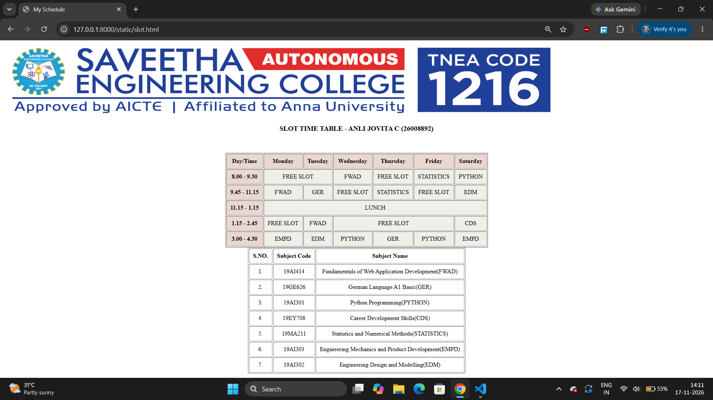

# Ex04 Time Table
## Date:17 November 2026

## AIM
To write a html webpage page to display your slot timetable.

## ALGORITHM
### STEP 1
Create a Django-admin Interface.

### STEP 2
Create an App inside the Django project.

### STEP 2
Create a static folder uder the created App and insert HTML code.

### STEP 3
Create a simple table using ```<table>``` tag in html with the relevant attributes.

### STEP 4
Add rows using ```<tr>``` tag.

### STEP 5
Add your course schedule using ```<td>``` tag.

### STEP 6
Execute the program using runserver command.

## PROGRAM
```
<html>
    <head>
        <title>My Schedule</title>
    </head>
    <body>
        
        <table border="1" cellspacing="2" cellpadding="10" bgcolor="efefe9" align="center">
        <h3 align="center">SLOT TIME TABLE - ANLI JOVITA C (26008892)</h3>
        <tr bgcolor="ead7d1" align="center">
            <th>Day/Time</th>
            <th>Monday</th>
            <th>Tuesday</th>
            <th>Wednesday</th>
            <th>Thursday</th>
            <th>Friday</th>
            <th>Saturday</th>
        </tr>
        <tr align="center">
        <td bgcolor="ead7d1"><b>8.00 - 9.30</b></td>
        <td colspan="2" align="center">FREE SLOT</td>
        <td>FWAD</td>
        <td>FREE SLOT</td>
        <td>STATISTICS</td>
        <td>PYTHON</td>
        </tr>
        <tr align="center">
            <td bgcolor="ead7d1"><b>9.45 - 11.15</b></td>
            <td>FWAD</td>
            <td>GER</td>
            <td>FREE SLOT</td>
            <td>STATISTICS</td>
            <td>FREE SLOT</td>
            <td>EDM</td>
        </tr>
        <tr align="center">
        <td bgcolor="ead7d1"><b>11.15 - 1.15</b></td>
        <td colspan="6" align="center">LUNCH</td>
        </tr>
        <tr align="center">
            <td bgcolor="ead7d1"><b>1.15 - 2.45</b></td>
            <td>FREE SLOT</td>
            <td>FWAD</td>
            <td colspan="3" align="center">FREE SLOT</td>
            <td>CDS</td>
        </tr>
        <tr align="center">
            <td bgcolor="ead7d1"><b>3.00 - 4.30</b></td>
            <td>EMPD</td>
            <td>EDM</td>
            <td>PYTHON</td>
            <td>GER</td>
            <td>PYTHON</td>
            <td>EMPD</td>
        </tr>
        
        <br><br>    

        <table border="1" cellspacing="2" cellpadding="10" align="center">
            <tr align="center">
                <th>S.NO.</th>
                <th>Subject Code</th>
                <th>Subject Name</th>
            </tr>
            <tr align="center">
                <td>1.</td>
                <td>19AI414</td>
                <td>Fundamentals of Web Application Development(FWAD)</td>
            </tr>
            <tr align="center">
                <td>2.</td>
                <td>19GE626</td>
                <td>German Language A1 Basic(GER)</td>
            </tr>
            <tr align="center">
                <td>3.</td>
                <td>19AI301</td>
                <td>Python Programming(PYTHON)</td>
            </tr>
            <tr align="center">
                <td>4.</td>
                <td>19EY708</td>
                <td>Career Development Skills(CDS)</td>
            </tr>
            <tr align="center">
                <td>5.</td>
                <td>19MA211</td>
                <td>Statistics and Numerical Methods(STATISTICS)</td>
            </tr>
            <tr align="center">
                <td>6.</td>
                <td>19AI303</td>
                <td>Engineering Mechanics and Product Development(EMPD)</td>
            </tr>
            <tr align="center">
                <td>7.</td>
                <td>19AI302</td>
                <td>Engineering Design and Modelling(EDM)</td>
            </tr>

    </body>

</html>
```

## OUTPUT


## RESULT
The program for creating slot timetable using basic HTML tags is executed successfully.
